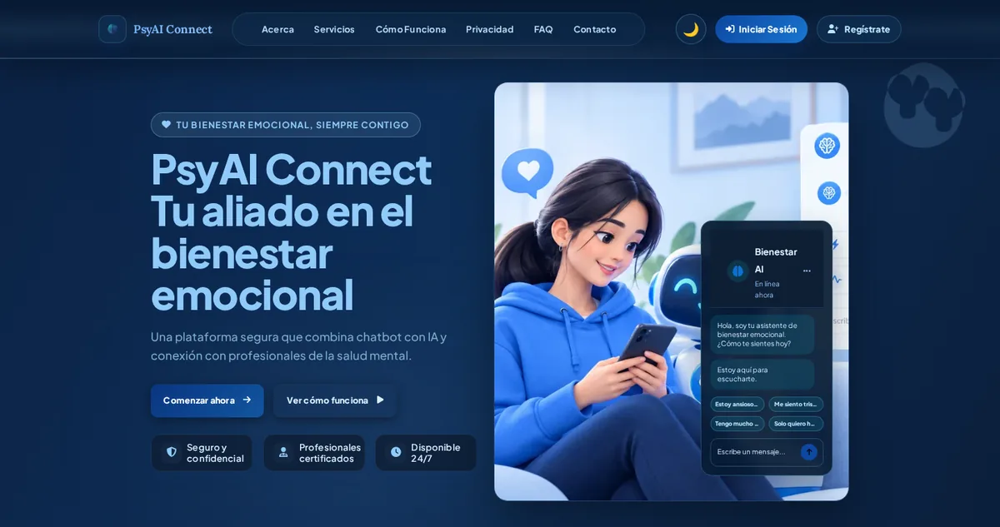
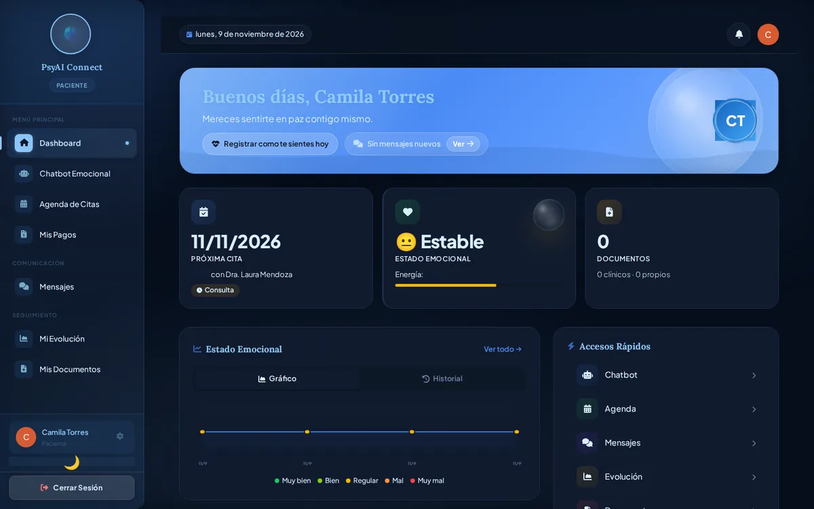
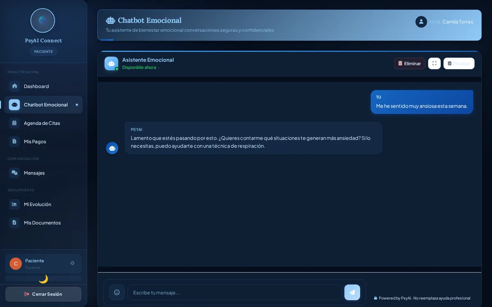
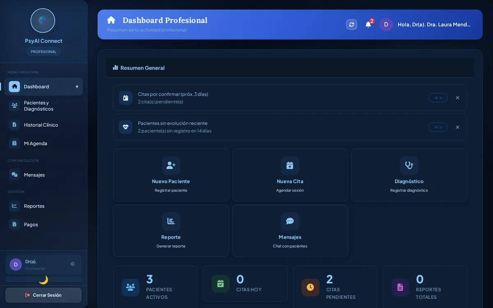
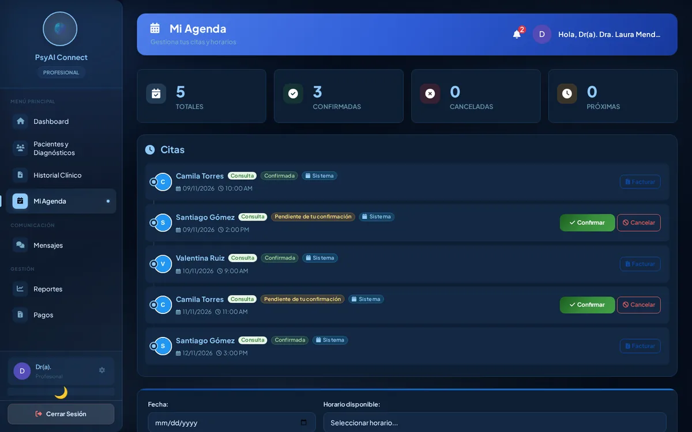
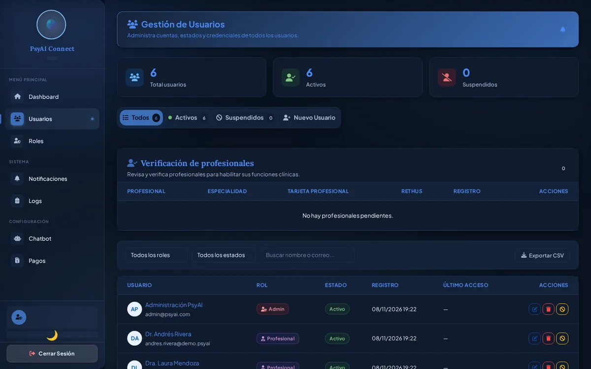

<div align="center">
  
  <h1>PsyAI Connect</h1>
  <p><strong>Gestión clínica para conectar pacientes y profesionales de psicología.</strong></p>
  <p>Agenda, seguimiento y comunicación en una sola plataforma, con asistencia de IA.</p>
  <p>
    <a href="https://python.org"></a>
    <a href="https://djangoproject.com"></a>
    <a href="https://django-rest-framework.org"></a>
    
    
    
  </p>
  <p>
    <a href="#qué-es">Qué es</a> ·
    <a href="#capturas">Capturas</a> ·
    <a href="#funcionalidades">Funcionalidades</a> ·
    <a href="#inicio-rápido">Inicio rápido</a> ·
    <a href="#configuración">Configuración</a> ·
    <a href="#pruebas">Pruebas</a> ·
    <a href="#documentación">Documentación</a>
  </p>
</div>

---

## 💡 Qué es

PsyAI Connect digitaliza la operación de un consultorio o red de psicólogos. Reúne en una sola aplicación web tres espacios de trabajo, cada uno con su propio rol y permisos:

| Portal | Qué puede hacer |
|---|---|
| **Paciente** | Agendar citas, registrar su evolución, consultar documentos autorizados, conversar con su profesional y con el chatbot de apoyo. |
| **Profesional** | Gestionar disponibilidad y citas, atender pacientes asignados, llevar diagnósticos e historia clínica, compartir documentos, crear reportes y facturar. |
| **Administración** | Gestionar usuarios y roles, verificar profesionales, revisar logs y métricas en vivo, y configurar el chatbot. |

## 🖼️ Capturas

<p align="center">
  
</p>

<table>
  <tr>
    <td width="50%" align="center"><br><sub><b>Paciente</b> · Dashboard con próxima cita y estado emocional</sub></td>
    <td width="50%" align="center"><br><sub><b>Paciente</b> · Chatbot emocional con IA</sub></td>
  </tr>
  <tr>
    <td width="50%" align="center"><br><sub><b>Profesional</b> · Resumen de actividad y alertas</sub></td>
    <td width="50%" align="center"><br><sub><b>Profesional</b> · Agenda: confirmar, cancelar y facturar citas</sub></td>
  </tr>
  <tr>
    <td colspan="2" align="center"><br><sub><b>Administración</b> · Gestión de usuarios, roles y verificación de profesionales</sub></td>
  </tr>
</table>

<sub>Capturas del tema oscuro con datos de demostración ficticios. La interfaz también tiene tema claro.</sub>

## ✨ Funcionalidades

### 📅 Agenda clínica
- Disponibilidad del profesional, citas con estados (Pendiente, Confirmada, Completada, Cancelada) y recordatorios.
- Control de conflictos: no puede haber dos citas activas del mismo profesional a la misma fecha y hora.

### 📈 Seguimiento del paciente
- Evolución diaria, anamnesis, diagnósticos y reportes.
- Documentos clínicos con visibilidad y autorización controladas por el paciente.

### 🤖 Chatbot con IA (Google Gemini)
- Apoyo conversacional con prompt y configuración editables desde el panel de administración.
- Detección de riesgo emocional por niveles (alto, medio, bajo) con términos configurables y aviso a los profesionales.
- Rotación de varias API keys, límite diario de mensajes y respuesta local de respaldo si Gemini no está disponible.
- Prediagnóstico generado a partir de la conversación, visible para el profesional.

### 💬 Comunicación
- Chat paciente-profesional en tiempo real (SSE).
- Correos transaccionales por SMTP y notificaciones por WhatsApp (Twilio), esta última opcional.

### 🔐 Acceso y seguridad
- Registro, inicio de sesión, recuperación de contraseña y verificación de correo.
- Inicio de sesión con Google (allauth).
- Contraseñas con Argon2id, CSRF, límites de peticiones y permisos por rol.

### 🧾 Operación
- Facturación manual: el profesional confirma el pago con evidencia, sin pasarela automática.
- Panel de administración con métricas del sistema, auditoría de accesos y registros de actividad.
- Interfaz adaptable a móvil, tablet y escritorio, con tema claro y oscuro.

## 🧱 Tecnología y arquitectura

| Área | Tecnologías |
|---|---|
| Backend | Python, Django 5, Django REST Framework, PostgreSQL 16 |
| Frontend | Django Templates, Bootstrap 5, CSS modular y JavaScript (ES6+) |
| IA y mensajería | Google Gemini, SMTP, Twilio WhatsApp (opcional) |
| Seguridad | Sesiones, CSRF, permisos por rol, Argon2id, django-ratelimit |
| Despliegue y pruebas | Docker Compose, Waitress, pytest, pytest-django, pytest-cov |

Cada módulo sigue el mismo patrón de cuatro capas:

```text
URL → Vista → Servicio → Repositorio → PostgreSQL
```

| Capa | Archivo | Responsabilidad |
|---|---|---|
| Vista | `views.py` | Recibe la petición, valida el rol y responde. |
| Servicio | `services.py` | **Reglas de negocio.** Es donde está la lógica. |
| Repositorio | `repositories.py` | Único punto de acceso a la base de datos. |
| Modelo | `models.py` | Tablas y restricciones. |

Los permisos reutilizables están en `apps/core/permissions.py`. Los endpoints viven bajo `/api/`.

### 🧩 Aplicaciones

| App | Función |
|---|---|
| `authentication` | Registro, login, recuperación de contraseña, verificación de correo, consentimientos. |
| `patients` | Perfil, evolución, anamnesis y derechos del titular de datos. |
| `professionals` | Perfil, pacientes asignados, diagnósticos, reportes y verificación. |
| `scheduling` | Disponibilidad, citas y notificaciones. |
| `documents` | Documentos clínicos y autorizaciones. |
| `billing` | Facturas con pago manual y evidencia. |
| `chatbot` | Chatbot Gemini, chat en tiempo real y configuración de IA. |
| `admin_panel` | Usuarios, roles, logs, métricas y telemetría. |
| `core` | Permisos, middlewares, notificaciones y utilidades comunes. |

## 🚀 Inicio rápido

### 📋 Requisitos

- **Docker y Docker Compose** (recomendado), o bien Python 3.10+ y PostgreSQL 16+.
- Una API key de [Google AI Studio](https://aistudio.google.com/) para el chatbot. Sin ella, el chatbot responde con el modo de respaldo local.

### 🐳 Con Docker

```bash
git clone https://github.com/ArleyRojo/PsyAI-Connect.git
cd PsyAI-Connect
cp .env.example .env
# Edita .env: SECRET_KEY y, si quieres IA, GEMINI_API_KEY
docker compose -f install/docker-compose.yml up -d --build
```

Abre <http://localhost:8000>. En desarrollo, el contenedor espera a PostgreSQL, aplica las migraciones y crea un administrador de demostración si no existe:

| Usuario | Contraseña |
|---|---|
| `admin@psyai.com` | `Admin123` |

> **Solo para desarrollo.** Este usuario se crea únicamente con `config.settings.dev`. Cámbialo o elimínalo antes de exponer la aplicación.

Comandos útiles:

```bash
docker compose -f install/docker-compose.yml logs -f app     # ver logs
docker compose -f install/docker-compose.yml exec app bash   # abrir una terminal
docker compose -f install/docker-compose.yml down            # detener
```

### 💻 Instalación manual

```bash
git clone https://github.com/ArleyRojo/PsyAI-Connect.git
cd PsyAI-Connect
python -m venv venv
# Linux/macOS
source venv/bin/activate
# Windows PowerShell: .\venv\Scripts\Activate.ps1
pip install -r requirements.txt
cp .env.example .env
# Configura PostgreSQL (DB_*) y el resto de variables en .env
python manage.py migrate
python manage.py createsuperuser
python manage.py runserver
```

También puedes ejecutar `python install/install.py` para crear el entorno virtual e instalar las dependencias automáticamente.

En desarrollo, si no defines SMTP, los correos se imprimen en la consola.

### ✅ Primeros pasos

1. Entra con el administrador.
2. Desde el panel de administración crea usuarios y asígnales rol de profesional o paciente.
3. Verifica al profesional y define su disponibilidad.
4. Entra como paciente y agenda una cita.

## ⚙️ Configuración

Toda la configuración se hace con variables de entorno en `.env`. Las más importantes:

| Variable | Para qué sirve | Obligatoria |
|---|---|---|
| `SECRET_KEY` | Clave secreta de Django. En producción debe ser larga y segura. | Sí (producción) |
| `DB_NAME`, `DB_USER`, `DB_PASSWORD`, `DB_HOST`, `DB_PORT` | Conexión a PostgreSQL. Docker ya las define por defecto. | Sí |
| `GEMINI_API_KEY` | API key del chatbot. Para rotar varias, usa `GEMINI_API_KEYS` separadas por comas. | Para usar IA |
| `GEMINI_MODEL`, `GEMINI_THINKING_LEVEL` | Modelo y nivel de razonamiento de Gemini. | No |
| `EMAIL_*`, `DEFAULT_FROM_EMAIL` | Servidor SMTP para correos transaccionales. | En producción |
| `SITE_URL` | URL pública, usada en los enlaces de los correos. | En producción |
| `GOOGLE_CLIENT_ID`, `GOOGLE_CLIENT_SECRET` | Inicio de sesión con Google. | No |
| `PAGO_CUENTA_URL`, `PAGO_CUENTA_NOMBRE`, `CITA_MONTO_DEFAULT` | Datos del pago manual y precio por defecto de una cita. | No |
| `LOGIN_RATE_LIMIT`, `REGISTER_RATE_LIMIT`, `PASSWORD_RECOVERY_RATE_LIMIT` | Límites de peticiones en autenticación. | No |
| `WHATSAPP_ENABLED`, `TWILIO_*` | Notificaciones por WhatsApp. | No |

La lista completa y comentada está en [`.env.example`](.env.example).

### 🌐 Producción

```bash
docker compose -f install/docker-compose.yml -f install/docker-compose.prod.yml up -d --build
```

La configuración de producción usa Waitress, exige `SECRET_KEY`, redirige a HTTPS, activa HSTS y marca las cookies como seguras. Consulta [docs/deployment.md](docs/deployment.md) para el checklist completo.

## 🧪 Pruebas

```bash
# Linux/macOS
export DJANGO_SETTINGS_MODULE=config.settings.test
pytest --tb=short -q

# Con cobertura
pytest --cov=apps --cov-report=term-missing

# Una sola app
pytest apps/chatbot/tests/ -v

# Dentro de Docker
docker compose -f install/docker-compose.yml exec app python -m pytest apps/ -q
```

Las pruebas usan PostgreSQL. Los tests marcados como `integration` requieren que la base de datos esté disponible; para omitirlos usa `pytest -m "not integration"`.

## 📚 Documentación

La documentación técnica está en [`docs/`](docs/README.md), organizada por tema:

| Tema | Guía |
|---|---|
| Índice | [docs/README.md](docs/README.md) |
| Arquitectura | [docs/architecture.md](docs/architecture.md) |
| API REST | [docs/api.md](docs/api.md) |
| Modelos de datos | [docs/data-models.md](docs/data-models.md) |
| Roles y permisos | [docs/roles-and-permissions.md](docs/roles-and-permissions.md) |
| Seguridad | [docs/security.md](docs/security.md) |
| Chatbot e IA | [docs/chatbot-ai.md](docs/chatbot-ai.md) |
| Integraciones | [docs/integrations.md](docs/integrations.md) |
| Frontend | [docs/frontend.md](docs/frontend.md) |
| Despliegue | [docs/deployment.md](docs/deployment.md) |
| Testing | [docs/testing.md](docs/testing.md) |

<details>
  <summary>Documentos del proyecto (casos de uso, mockups, UML y más)</summary>

| Documento | Enlace |
|---|---|
| Casos de uso | [PDF](https://docs.google.com/viewer?url=https%3A%2F%2Fgithub.com%2FManuelRojas22%2FPsyAi-Connect%2Freleases%2Flatest%2Fdownload%2FCasos_de_Uso_PsyAI_Connect_1.pdf&embedded=true) |
| Historias de usuario | [PDF](https://docs.google.com/viewer?url=https%3A%2F%2Fgithub.com%2FManuelRojas22%2FPsyAi-Connect%2Freleases%2Flatest%2Fdownload%2FHistorias_de_Usuario_PsyAI_Connect.pdf&embedded=true) |
| Manual de usuario | [PDF](https://docs.google.com/viewer?url=https%3A%2F%2Fgithub.com%2FManuelRojas22%2FPsyAi-Connect%2Freleases%2Flatest%2Fdownload%2FManual_Usuario_PsyAI_Connect_1.1.pdf&embedded=true) |
| Matriz de requisitos | [XLSX](https://docs.google.com/viewer?url=https%3A%2F%2Fgithub.com%2FManuelRojas22%2FPsyAi-Connect%2Freleases%2Flatest%2Fdownload%2FMatriz_de_requisitos_PsyAi_Connect_actualizada_v2.xlsx&embedded=true) |
| Mockups | [PDF](https://docs.google.com/viewer?url=https%3A%2F%2Fgithub.com%2FManuelRojas22%2FPsyAi-Connect%2Freleases%2Flatest%2Fdownload%2Fmockups.1.pdf&embedded=true) |
| Diagramas UML | [PDF](https://docs.google.com/viewer?url=https%3A%2F%2Fgithub.com%2FManuelRojas22%2FPsyAi-Connect%2Freleases%2Flatest%2Fdownload%2FPsyAI_Connect_Diagramas_UML.pdf&embedded=true) |
| Guía de marca | [PDF](https://docs.google.com/viewer?url=https%3A%2F%2Fgithub.com%2FManuelRojas22%2FPsyAi-Connect%2Freleases%2Flatest%2Fdownload%2FPsyAI-Connect-Guia-de-marca.pdf&embedded=true) |
| Mapa de navegación | [PDF](https://docs.google.com/viewer?url=https%3A%2F%2Fgithub.com%2FManuelRojas22%2FPsyAi-Connect%2Freleases%2Flatest%2Fdownload%2FPsyAI-Connect-Mapa-de-navegacion-oscuro.1.pdf&embedded=true) |

</details>

## 🗂️ Estructura del proyecto

```text
PsyAI-Connect/
├── apps/            # Aplicaciones Django (una carpeta por módulo)
├── config/          # URLs y settings: base, dev, prod y test
├── docs/            # Documentación técnica y capturas (docs/screenshots)
├── install/         # Dockerfile, Compose, entrypoint e instalador
├── static/          # CSS, JavaScript e imágenes
├── templates/       # Plantillas por rol: patient, professional, admin, auth
├── tests/           # Pruebas de integración
├── manage.py
├── requirements.txt
├── pytest.ini
└── .env.example
```

## 🤝 Contribuir

1. Crea un fork y una rama para tu cambio: `git checkout -b feature/mi-cambio`.
2. Mantén el patrón de capas: la lógica de negocio va en `services.py`, el acceso a datos en `repositories.py`.
3. Ejecuta las pruebas pertinentes antes de enviar el cambio.
4. Abre un pull request con un resumen de lo que cambió y por qué.

## 📄 Licencia

Uso educativo e interno. Consulta el repositorio para más detalles.

<div align="center">
  <sub>Desarrollado por <a href="https://github.com/ArleyRojo">Arley Rojo</a></sub>
</div>
