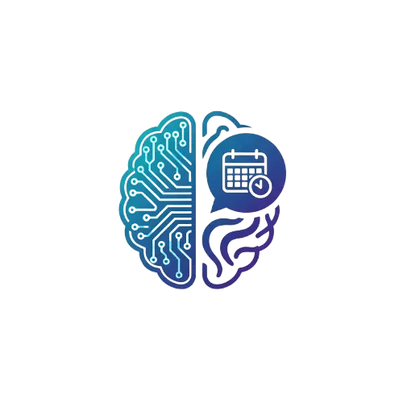

<div align="center">
  
  <h1>PsyAI Connect</h1>
  <p><strong>Gestión clínica para conectar pacientes y profesionales de psicología.</strong></p>
  <p>Agenda, seguimiento y comunicación en una plataforma con asistencia de IA.</p>
  <p>
    <a href="https://python.org"></a>
    <a href="https://djangoproject.com"></a>
    <a href="https://django-rest-framework.org"></a>
    
    
    
  </p>
  <p><a href="#inicio-rápido">Empezar</a> · <a href="#documentación">Documentación</a> · <a href="#pruebas">Pruebas</a></p>
</div>

---

## Producto

PsyAI Connect reúne tres espacios de trabajo:

| Portal | Funciones principales |
|---|---|
| **Paciente** | Agenda citas, registra su evolución, consulta documentos y conversa con profesionales o con el chatbot. |
| **Profesional** | Gestiona disponibilidad y citas, atiende pacientes asignados, comparte documentos y crea reportes. |
| **Administración** | Gestiona usuarios y roles, revisa actividad y métricas, y configura el chatbot. |

### Funcionalidades

- **Agenda clínica:** disponibilidad, citas, estados y recordatorios.
- **Seguimiento:** evolución del paciente, historia clínica y documentos autorizados.
- **Comunicación:** mensajería paciente-profesional y chatbot con Google Gemini.
- **Operación:** gestión de usuarios, notificaciones, reportes y facturación manual con evidencia de pago.
- **Panel en vivo:** métricas y registros de actividad transmitidos con SSE.
- **Interfaz adaptable:** vistas para móvil, tablet y escritorio, con tema claro y oscuro.

## Tecnología y arquitectura

| Área | Tecnologías |
|---|---|
| Backend | Python, Django 5, Django REST Framework, PostgreSQL |
| Frontend | Django Templates, Bootstrap 5, CSS modular y JavaScript ES6+ |
| IA y correo | Google Gemini y correo SMTP configurable |
| Seguridad | Sesiones, CSRF, permisos por rol, Argon2id y límites de peticiones |
| Despliegue y pruebas | Docker Compose, Waitress, pytest y pytest-django |

```text
Vistas → Servicios → Repositorios → PostgreSQL
```

Las vistas gestionan páginas y API REST (`/api/`); los servicios contienen reglas de negocio; los repositorios agrupan el acceso a datos. Los permisos están en `apps/core/permissions.py`.

## Inicio rápido

### Requisitos

- Docker y Docker Compose, o Python 3.10+ y PostgreSQL 16+.
- Una API key de [Google AI Studio](https://aistudio.google.com/) para usar el chatbot.

### Con Docker

```bash
git clone https://github.com/ArleyRojo/PsyAI-Connect.git
cd PsyAI-Connect
cp .env.example .env
# Ajusta SECRET_KEY y las credenciales necesarias en .env
docker compose -f install/docker-compose.yml up -d --build
```

Abre <http://localhost:8000>. En desarrollo, el contenedor aplica migraciones y crea el usuario de demostración `admin@psyai.com` / `Admin123` si aún no existe. No uses esas credenciales en producción.

### Instalación manual

```bash
git clone https://github.com/ArleyRojo/PsyAI-Connect.git
cd PsyAI-Connect
python -m venv venv
# Linux/macOS
source venv/bin/activate
# Windows PowerShell: .\venv\Scripts\Activate.ps1
pip install -r requirements.txt
cp .env.example .env
# Configura PostgreSQL y las variables de .env
python manage.py migrate
python manage.py createsuperuser
python manage.py runserver
```

La configuración de desarrollo envía correos a la consola si no se define SMTP. Consulta [`.env.example`](.env.example) y [deployment.md](docs/deployment.md) para el resto de opciones.

## Pruebas

```bash
# Linux/macOS
export DJANGO_SETTINGS_MODULE=config.settings.test
pytest --tb=short -q

# Cobertura
pytest --cov=apps --cov-report=term-missing
```

También puedes ejecutar pruebas por aplicación, por ejemplo `pytest apps/chatbot/tests/ -v`. La configuración de test usa PostgreSQL; los tests de integración requieren que la base de datos esté disponible.

## Documentación

La documentación técnica está organizada por tema:

| Tema | Guía |
|---|---|
| Índice | [docs/README.md](docs/README.md) |
| API REST | [docs/api.md](docs/api.md) |
| Seguridad | [docs/security.md](docs/security.md) |
| Roles y permisos | [docs/roles-and-permissions.md](docs/roles-and-permissions.md) |
| Modelos de datos | [docs/data-models.md](docs/data-models.md) |
| Arquitectura | [docs/architecture.md](docs/architecture.md) |
| Frontend | [docs/frontend.md](docs/frontend.md) |
| Chatbot e IA | [docs/chatbot-ai.md](docs/chatbot-ai.md) |
| Integraciones | [docs/integrations.md](docs/integrations.md) |
| Despliegue | [docs/deployment.md](docs/deployment.md) |
| Testing | [docs/testing.md](docs/testing.md) |

<details>
  <summary>Documentos del proyecto</summary>

| Documento | Enlace |
|---|---|
| Casos de uso | [PDF](https://docs.google.com/viewer?url=https%3A%2F%2Fgithub.com%2FManuelRojas22%2FPsyAi-Connect%2Freleases%2Flatest%2Fdownload%2FCasos_de_Uso_PsyAI_Connect_1.pdf&embedded=true) |
| Historias de usuario | [PDF](https://docs.google.com/viewer?url=https%3A%2F%2Fgithub.com%2FManuelRojas22%2FPsyAi-Connect%2Freleases%2Flatest%2Fdownload%2FHistorias_de_Usuario_PsyAI_Connect.pdf&embedded=true) |
| Manual de usuario | [PDF](https://docs.google.com/viewer?url=https%3A%2F%2Fgithub.com%2FManuelRojas22%2FPsyAi-Connect%2Freleases%2Flatest%2Fdownload%2FManual_Usuario_PsyAI_Connect_1.1.pdf&embedded=true) |
| Matriz de requisitos | [XLSX](https://docs.google.com/viewer?url=https%3A%2F%2Fgithub.com%2FManuelRojas22%2FPsyAi-Connect%2Freleases%2Flatest%2Fdownload%2FMatriz_de_requisitos_PsyAi_Connect_actualizada_v2.xlsx&embedded=true) |
| Mockups | [PDF](https://docs.google.com/viewer?url=https%3A%2F%2Fgithub.com%2FManuelRojas22%2FPsyAi-Connect%2Freleases%2Flatest%2Fdownload%2Fmockups.1.pdf&embedded=true) |
| Diagramas UML | [PDF](https://docs.google.com/viewer?url=https%3A%2F%2Fgithub.com%2FManuelRojas22%2FPsyAi-Connect%2Freleases%2Flatest%2Fdownload%2FPsyAI_Connect_Diagramas_UML.pdf&embedded=true) |
| Guía de marca | [PDF](https://docs.google.com/viewer?url=https%3A%2F%2Fgithub.com%2FManuelRojas22%2FPsyAi-Connect%2Freleases%2Flatest%2Fdownload%2FPsyAI-Connect-Guia-de-marca.pdf&embedded=true) |
| Mapa de navegación | [PDF](https://docs.google.com/viewer?url=https%3A%2F%2Fgithub.com%2FManuelRojas22%2FPsyAi-Connect%2Freleases%2Flatest%2Fdownload%2FPsyAI-Connect-Mapa-de-navegacion-oscuro.1.pdf&embedded=true) |

</details>

## Estructura

```text
PsyAI-Connect/
├── apps/          # Aplicaciones Django
├── config/        # URLs y configuraciones base/dev/prod/test
├── docs/          # Documentación del proyecto
├── install/       # Docker, Compose e instalador
├── static/        # CSS, JavaScript e imágenes
├── templates/     # Plantillas Django
├── manage.py
├── requirements.txt
└── pytest.ini
```

## Contribuir

1. Crea un fork y una rama para tu cambio.
2. Ejecuta las pruebas pertinentes.
3. Envía un pull request con un resumen de los cambios.

## Licencia

Uso educativo e interno. Consulta el repositorio para más detalles.

<div align="center">
  <sub>Desarrollado por <a href="https://github.com/ArleyRojo">Arley Rojo</a></sub>
</div>