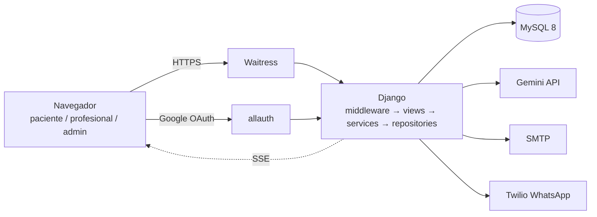
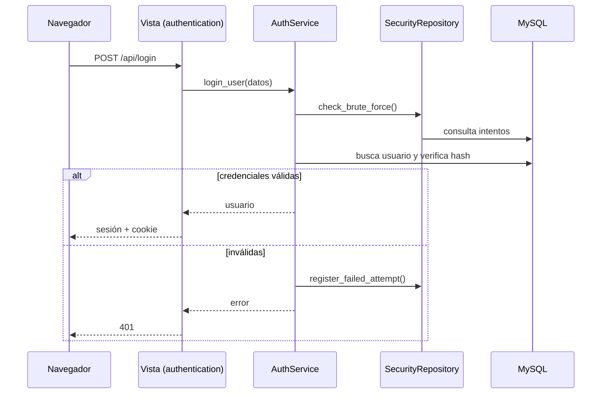
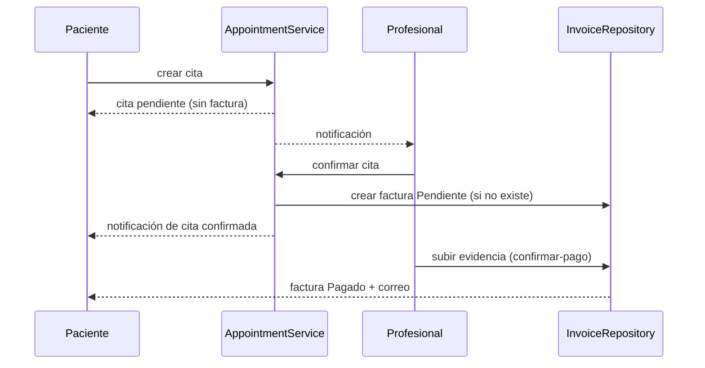
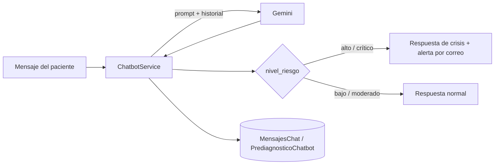
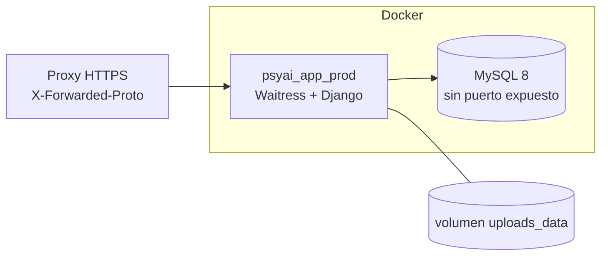

# Arquitectura — PsyAI Connect

Plataforma web de bienestar emocional que combina un chatbot con IA y la conexión entre pacientes y profesionales de la salud mental. Este documento describe la arquitectura **según el código actual**. Para el detalle de cada área ver también `api.md`, `data-models.md`, `roles-and-permissions.md`, `security.md`, `deployment.md` y `testing.md`.

## 1. Stack

| Capa | Tecnología |
|---|---|
| Backend | Django 5.2, Django REST Framework, django-allauth (login con Google) |
| Base de datos | MySQL 8 (SQLite en memoria para las pruebas) |
| Frontend | Plantillas Django, Bootstrap 5, JavaScript modular (`static/js/{base,components,core,modules}`), CSS por rol |
| IA | Google Gemini (respuestas del chatbot y prediagnóstico), con modelo de respaldo configurable |
| Mensajería | SMTP (correos), WhatsApp vía Twilio (con proveedor `Dummy` para desarrollo) |
| Servidor | Waitress en producción (`--threads=4` en `install/Dockerfile`), Docker multi-stage |
| Pruebas | pytest + pytest-django (`config.settings.test`) |

## 2. Vista general

El cobro de las citas es **manual** (link de cobro configurado por variables de entorno); no hay pasarela de pago integrada.

## 3. Capas

El diseño objetivo es **Views → Services → Repositories → MySQL**:

| Capa | Responsabilidad | Ubicación |
|---|---|---|
| Views | HTTP: permisos por rol, parseo de la petición, respuesta JSON o plantilla | `apps/<app>/views.py` |
| Services | Reglas de negocio, validaciones, transacciones, notificaciones | `apps/<app>/services.py` |
| Repositories | Único acceso a la base de datos (ORM y SQL) | `apps/<app>/repositories.py` |
| Models | Definición de tablas | `apps/<app>/models.py` |

### Estado real de las capas

La separación se cumple en la mayor parte del código, pero hay excepciones que conviene corregir:

| Hallazgo | Dónde |
|---|---|
| Vistas con llamadas directas al ORM (coincidencias de `.objects.` / `.filter(` en `views.py`) | `professionals` (5), `chatbot` (4), `core` (3), `authentication` (3), `admin_panel` (2), `scheduling`, `patients`, `billing` (1 c/u); `documents` (0) |
| Vistas que importan repositorios directamente, saltándose el servicio | `admin_panel`, `billing`, `professionals` |
| Servicios que reciben `request` | `authentication` (`register_user`, `recover_password` y el envío de verificación), `core.log_client_error` |
| Un servicio usando el repositorio de otra app | `scheduling` usa `InvoiceRepository` de `billing` al confirmar una cita |

## 4. Módulos

| App | Responsabilidad | Modelos principales |
|---|---|---|
| `authentication` | Registro, login, recuperación, verificación de correo, seguridad de contraseñas, intentos fallidos | `Login`, `RecoveryTokens`, `EmailVerificationToken`, `IntentosFallidos`, `TOTPDevice`, `ConsentimientoUsuario` |
| `patients` | Perfil, anamnesis, evolución, familiares, solicitud de derechos | `PerfilPaciente`, `Anamnesis`, `EvolucionPaciente`, `Familiar`, `SolicitudDerechos` |
| `professionals` | Perfil profesional, pacientes asignados, diagnósticos, reportes | `PerfilProfesional`, `PacientesProfesional`, `Diagnostico`, `Reportes`, `ProfessionalPaymentInfo` |
| `scheduling` | Citas, disponibilidad, notificaciones y recordatorios | `Citas`, `Disponibilidad`, `Notificaciones` |
| `chatbot` | Conversaciones con IA, prediagnóstico, nivel de riesgo, configuración | `ConversacionesChatbot`, `MensajesChat`, `PrediagnosticoChatbot`, `ChatbotConfig`, `EncuestaChatbot` |
| `billing` | Facturas y sus ítems, correo de factura | `Facturas`, `ItemsFactura` |
| `documents` | Documentos clínicos y autorizaciones | `DocumentosClinicos`, `DocumentosPaciente`, `AutorizacionesDocumento` |
| `admin_panel` | Panel de administración, estadísticas y logs en tiempo real | `AuditoriaAccesos`, `Logs` |
| `core` | Permisos, middleware, WhatsApp, webhooks, utilidades compartidas | `NewsletterSubscriber` |

Comandos de gestión (`manage.py`): `enviar_recordatorios`, `enviar_notificaciones_programadas`, `probar_whatsapp`, `send_daily_tips`, `limpiar_facturas`, `listar_menores`, `generar_hash`, `normalizar_roles`.

## 5. Cadena de middleware

Orden en `config/settings/base.py`:

1. `SecurityMiddleware`
2. `SessionMiddleware`
3. `CorsMiddleware`
4. `GZipMiddleware`
5. `CommonMiddleware`
6. `CsrfViewMiddleware`
7. `AuthenticationMiddleware`
8. `AccountStatusMiddleware` — bloquea cuentas inactivas o inexistentes
9. `MessageMiddleware`
10. `XFrameOptionsMiddleware`
11. allauth `AccountMiddleware`
12. `SecurityHeadersMiddleware` — CSP, `nosniff`, `Referrer-Policy`
13. `TelemetryMiddleware` — métricas de peticiones y latencia para el panel admin
14. `AuditActivityMiddleware` — auditoría de acciones

## 6. Autenticación y autorización

- **Sesiones en base de datos**, cookie `HttpOnly` y `SameSite=Lax`, duración de 7 días. En producción: cookies `Secure`, HSTS, redirección a HTTPS.
- **Login con correo/contraseña** y con **Google** (allauth).
- **Contraseñas:** las cuentas nuevas usan Argon2id; las cuentas antiguas con SHA-256 siguen pudiendo iniciar sesión.
- **Roles:** paciente, profesional y administrador, aplicados con clases de permisos DRF en `apps/core/permissions.py`: `IsPaciente`, `IsProfesional`, `IsAdmin`, `IsPacienteOrProfesional`, `IsAdminOrProfesional`, `IsOwnerOrStaff`.
- **Protección contra fuerza bruta** con `IntentosFallidos` y límite de intentos en registro y recuperación.

## 7. Flujos principales

### Cita y facturación

Crear una cita **no** genera factura. Cuando la profesional confirma la cita se crea, dentro de una transacción, una factura en estado `Pendiente` (`AppointmentService.update_status`, `apps/scheduling/services.py`). El cobro es manual: la profesional adjunta la evidencia del pago con `POST /api/facturas/<id>/confirmar-pago` y la factura pasa a `Pagado`.

### Chatbot y detección de riesgo

El chatbot envía el mensaje a Gemini con un prompt que pide un nivel de riesgo (`bajo`, `moderado`, `alto`, `crítico`). Ante ideación suicida o autolesión, la respuesta incluye la línea de crisis configurada (`DEFAULT_CRISIS_PHONE` en `chatbot/services.py`) y se puede enviar un correo de alerta (`emails/alerta_riesgo.html`). El resultado se guarda en `PrediagnosticoChatbot`.

## 8. Tiempo real

El panel de administración y parte del paciente usan **Server-Sent Events** (`StreamingHttpResponse`): `/api/admin/stats/stream` y `/api/admin/logs/stream` (con heartbeat y cierre al desconectar) y el flujo del chatbot.

## 9. Despliegue

- Imagen multi-stage con destinos `dev` y `prod` (`install/Dockerfile`); `entrypoint.sh` espera a MySQL, aplica migraciones y arranca.
- Producción: `config.settings.prod`, `DEBUG=0`, MySQL con healthcheck, reinicio automático.
- Salud: `/health/` y `/healthz/`.
- Detalles en `deployment.md`.

## 10. Puntos a vigilar

| Tema | Detalle |
|---|---|
| Caché | `LocMemCache`: cada proceso tiene la suya; no se comparte entre workers ni contenedores |
| Concurrencia | Waitress con 4 hilos; ajustar según la carga esperada |
| Cuentas SHA-256 antiguas | Siguen aceptadas; no se migran automáticamente |
| CSP | Permite `'unsafe-inline'` y hay manejadores `onclick` en plantillas |
| 2FA | Existe el modelo `TOTPDevice` y código asociado, pero la librería TOTP no figura en `requirements.txt` |
| Superusuario de prueba | `install/entrypoint.sh` crea un superusuario de demostración si no existe; revisar que no se use en producción |
| Rutas heredadas | Hay rutas `*_legacy` en `chatbot/urls.py` pendientes de retirar |
| `chatbot/services.py` | Archivo muy grande (~73 KB); candidato a dividirse en módulos |