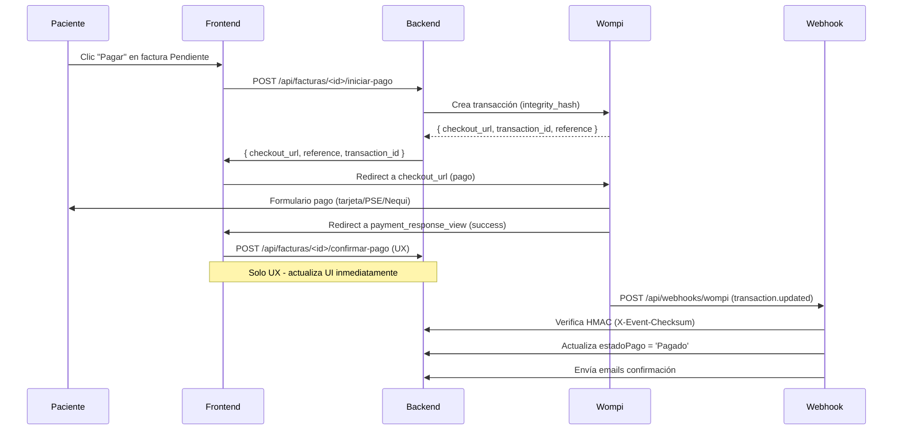

# Pagos y Facturación — PsyAI Connect

> **Resumen:** Flujo completo de facturación y pagos con pasarela Wompi: creación de facturas, inicio de pago, confirmación desde frontend y webhook autoritativo con verificación HMAC.  
> **Audiencia:** Desarrolladores que integran o mantienen el módulo de facturación.  
> **Nota clave:** La confirmación desde el **frontend es solo UX**; la **fuente de verdad real** es el **webhook de Wompi** que valida la firma HMAC.

---

## 1. Modelos principales

| Modelo | Tabla | Descripción |
|--------|-------|-------------|
| `Facturas` | `Facturas` | Factura cabecera (paciente, profesional, monto, estado, referencia Wompi) |
| `ItemsFactura` | `ItemsFactura` | Líneas de detalle (descripción, precio unitario) |

**Campos clave de `Facturas`:**
| Campo | Tipo | Detalle |
|-------|------|---------|
| `idFactura` | PK | |
| `idPaciente` / `idProfesional` | FK → `Register` | |
| `idCita` | IntegerField(null) | Vinculación opcional a cita |
| `monto` | Decimal(10,2) | Total |
| `metodoPago` | Choice | `tarjeta`, `pse`, `banco`, `efectivo`, `transferencia` |
| `estadoPago` | Choice | `Pendiente`, `Parcial`, `Pagado`, `Cancelado` |
| `anulada` | Boolean | Soft delete |
| `referenciaPago` | Char(64) | Hash de integridad Wompi (integrity_secret) |
| `idTransaccionPago` | Char(64) | ID de transacción Wompi |

---

## 2. Flujo completo



---

## 3. Paso a paso

### 3.1 Crear factura
**Endpoint:** `POST /api/facturas`  
**Auth:** `IsAuthenticatedDRF` (paciente, profesional, admin)  
**Body:**
```json
{
  "idPaciente": 123,          // requerido si profesional/admin
  "idProfesional": 456,       // requerido si paciente
  "idCita": 789,              // opcional
  "monto": "150000.00",
  "metodoPago": "tarjeta",
  "items": [
    { "descripcion": "Consulta psicológica", "precioUnitario": "150000.00" }
  ]
}
```
**Respuesta:** `{ success: true, factura: { idFactura, referenciaPago, ... } }`

---

### 3.2 Iniciar pago Wompi (`iniciar-pago`)
**Endpoint:** `POST /api/facturas/<id>/iniciar-pago`  
**Auth:** `IsAuthenticatedDRF`, `IsPaciente`  
**Proceso en `InvoiceService.init_wompi_payment()`:**

```python
def init_wompi_payment(self, factura_id, user_id):
    factura = self.repo.get_by_id(factura_id)
    # 1. Valida que la factura sea del paciente y esté Pendiente
    # 2. Genera reference único: "factura_<idFactura>_<timestamp>"
    # 3. Calcula integrity_hash = sha256(reference + amount_in_cents + currency + WOMPI_INTEGRITY_SECRET)
    # 4. Llama a Wompi API: POST /v1/transactions
    #    Body: { amount_in_cents, currency="COP", reference, signature: integrity_hash, ... }
    # 5. Guarda referenciaPago = reference, idTransaccionPago = transaction.id
    # 6. Retorna checkout_url para redirect
```

**Respuesta al frontend:**
```json
{
  "success": true,
  "checkout_url": "https://checkout.wompi.co/p/...",
  "reference": "factura_123_1700000000",
  "transaction_id": "txn_abc123"
}
```

---

### 3.3 Checkout en Wompi (Frontend)

**`static/js/modules/patient/agendaquotes.js` → `iniciarPagoWompi()`:**
```javascript
async function iniciarPagoWompi(facturaId) {
  const res = await fetchWithCsrf(`/api/facturas/${facturaId}/iniciar-pago`, {
    method: 'POST',
    credentials: 'include'
  });
  const data = await res.json();
  if (data.checkout_url) {
    // Redirect completo (no AJAX) para que Wompi maneje el pago
    window.location.href = data.checkout_url;
  }
}
```

> **Importante:** Es un **redirect completo** (`window.location.href`), no AJAX, porque Wompi necesita controlar la ventana para 3D Secure, PSE, etc.

---

### 3.4 Confirmación desde Frontend (Solo UX)

**Endpoint:** `POST /api/facturas/<id>/confirmar-pago`  
**Auth:** `IsAuthenticatedDRF`, `IsPaciente`  
**Body:** `{ "transactionId": "txn_abc123" }`

**En `InvoiceService.confirm_wompi_payment()`:**
```python
def confirm_wompi_payment(self, factura_id, transaction_id, user_id):
    # 1. Valida que la factura pertenezca al paciente
    # 2. Opcional: consulta a Wompi GET /v1/transactions/{transaction_id}
    # 3. Si status == "APPROVED" -> actualiza estadoPago = "Pagado"
    #    Guarda idTransaccionPago
    # 4. Retorna éxito
```

> **⚠️ Esto NO es la confirmación definitiva.** El frontend llama a esto tras el redirect de éxito de Wompi para actualizar la UI inmediatamente. Pero **Wompi puede fallar después** (rechazo bancario, fraude, etc.). La única confirmación **autorizada** es el webhook.

---

### 3.5 Webhook autoritativo — `WebhookWompiView`

**Endpoint:** `POST /api/webhooks/wompi` (público, sin auth)  
**Decorador:** `@method_decorator(csrf_exempt, name='dispatch')`

#### Verificación HMAC (fuente de verdad)

```python
# apps/billing/views.py - WebhookWompiView.post()
def post(self, request):
    events_secret = settings.WOMPI_EVENTS_SECRET
    raw_body = request.body.decode("utf-8")
    event = json.loads(raw_body)

    # 1. Obtiene checksum del header o payload
    checksum_header = request.headers.get("X-Event-Checksum", "")
    payload_checksum = (event.get("signature") or {}).get("checksum", "")
    expected_checksum = (checksum_header or payload_checksum).upper()

    # 2. Reconstruye el string a firmar (propiedades ordenadas + timestamp + secret)
    props = (event.get("signature") or {}).get("properties", [])
    raw_values = ""
    for prop in props:
        parts = prop.split(".")
        val = event
        for p in parts:
            val = val.get(p, "") if isinstance(val, dict) else ""
        raw_values += str(val)

    raw_to_sign = f"{raw_values}{event.get('timestamp', 0)}{events_secret}"
    computed = hashlib.sha256(raw_to_sign.encode()).hexdigest().upper()

    # 3. Comparación en tiempo constante
    if not hmac.compare_digest(computed, expected_checksum):
        logger.warning("Wompi webhook: firma inválida")
        return HttpResponse("", status=200)  # Siempre 200 para no reintentar

    # 4. Procesa solo transaction.updated APPROVED
    if event.get("event") != "transaction.updated":
        return HttpResponse("", status=200)

    transaction = event.get("data", {}).get("transaction", {})
    if transaction.get("status") != "APPROVED":
        return HttpResponse("", status=200)

    # 5. Busca factura por reference y actualiza
    reference = transaction.get("reference", "")
    invoice_id = self.repo.get_invoice_by_reference(reference)
    if invoice_id:
        self.repo.update_payment_status(invoice_id, "Pagado")
        self.repo.set_payment_reference(invoice_id, reference, transaction.get("id"))
        _send_webhook_payment_emails(invoice_id)  # Emails a paciente y profesional

    return HttpResponse("", status=200)
```

**Puntos críticos:**
1. **Siempre responde 200** (incluso si firma inválida) para evitar reintentos infinitos de Wompi.
2. `hmac.compare_digest()` previene timing attacks.
3. Solo procesa `transaction.updated` con `status=APPROVED`.
4. Busca factura por `reference` (generado en `iniciar-pago`).
5. Actualiza `estadoPago = "Pagado"`, guarda `idTransaccionPago` y `referenciaPago`.
6. Envía emails de confirmación a paciente y profesional.

---

### 3.6 Diferencia clave: Frontend vs Webhook

| Aspecto | Frontend (`confirmar-pago`) | Webhook (`WebhookWompiView`) |
|---------|----------------------------|------------------------------|
| **Propósito** | UX inmediata: usuario ve "Pagado" al volver | **Fuente de verdad**: dinero realmente recibido |
| **Confiabilidad** | Baja (usuario puede cerrar pestaña, red falla) | **Alta** (Wompi reintenta hasta 72h con backoff exponencial) |
| **Seguridad** | Ninguna (cualquiera puede llamar) | **HMAC-SHA256** con `WOMPI_EVENTS_SECRET` |
| **Estados manejados** | Solo `APPROVED` (asume éxito) | Todos: `APPROVED`, `DECLINED`, `VOIDED`, `ERROR` |
| **Reintentos** | Ninguno | Automáticos (Wompi reintenta hasta 72h) |
| **Emails** | No | Sí (paciente + profesional) |

> **Regla de oro:** El estado `Pagado` en BD **solo se considera definitivo** tras procesar el webhook. El frontend es optimista; el webhook es realista.

---

## 4. Endpoints de facturación (resumen)

| Método | Path | Auth | Roles | Descripción |
|--------|------|------|-------|-------------|
| GET | `/api/facturas` | Sí | Todos | Listar (filtrado por rol) |
| POST | `/api/facturas` | Sí | Todos | Crear factura |
| GET | `/api/facturas/<id>` | Sí | Todos | Detalle factura |
| PATCH | `/api/facturas/<id>` | Sí | Todos | Anular/actualizar estado |
| DELETE | `/api/facturas/<id>` | Sí | Todos | Anular (soft delete) |
| POST | `/api/facturas/<id>/iniciar-pago` | Sí | Paciente | Inicia checkout Wompi |
| POST | `/api/facturas/<id>/confirmar-pago` | Sí | Paciente | Confirma pago (UX) |
| DELETE | `/api/facturas/<id>/pago` | Sí | Paciente | Cancelar pago iniciado |
| GET | `/api/facturas/stats` | Sí | Todos | Estadísticas |
| GET | `/api/facturas/pacientes-profesional` | Sí | Profesional | Pacientes para facturar |
| POST | `/api/webhooks/wompi` | No | Webhook | Notificación Wompi (HMAC) |

---

## 5. Configuración Wompi (`.env`)

```bash
WOMPI_ENV=test                    # test | prod
WOMPI_PUBLIC_KEY=pub_...          # Llave pública (frontend)
WOMPI_PRIVATE_KEY=prv_...         # Llave privada (backend API calls)
WOMPI_INTEGRITY_SECRET=sec_...    # Secreto para hash de integridad (iniciar-pago)
WOMPI_EVENTS_SECRET=evt_...       # Secreto para verificación HMAC (webhook)
WOMPI_API_BASE=https://sandbox.wompi.co/v1  # o production.wompi.co/v1
```

> **Seguridad:** `WOMPI_INTEGRITY_SECRET` y `WOMPI_EVENTS_SECRET` son **distintos**. El primero firma la request de creación de transacción; el segundo verifica la firma del webhook entrante.

---

## 5. Correos de confirmación

Enviados **solo tras webhook exitoso** (`_send_webhook_payment_emails`):

| Destinatario | Template | Asunto |
|--------------|----------|--------|
| Paciente | `emails/pago_confirmado_webhook.html` | "PsyAI Connect — Pago confirmado" |
| Profesional | `emails/pago_confirmado_webhook.html` | "PsyAI Connect — Pago recibido" |

**Contexto del template:**
```python
{
  "id_factura": 123,
  "fecha": "25/01/2026 14:30",
  "monto": 150000,
  "metodo_pago": "tarjeta",
  "nombre_paciente": "Juan Pérez",
  "nombre_profesional": "Dra. María Torres",
  "cta_link": "https://dominio.com/aside-patient/facturas.html",
  "cta_texto": "Ver factura"
}
```

---

## Ver también

- [`modelos-de-datos.md`](modelos-de-datos.md#5-appsbilling--facturación) — Modelos `Facturas`, `ItemsFactura`
- [`frontend.md`](frontend.md) — `agendaquotes.js` inicia el pago
- [`roles-y-permisos.md`](roles-y-permisos.md#4-matriz-rol-funcionalidad) — Permisos de facturación por rol
- [`despliegue.md`](despliegue.md) — Variables de entorno Wompi
- [`seguridad.md`](seguridad.md) — HMAC, validación de webhook
- [`modelos-de-datos.md`](modelos-de-datos.md#5-appsbilling--facturación) — Modelos `Facturas`, `ItemsFactura`